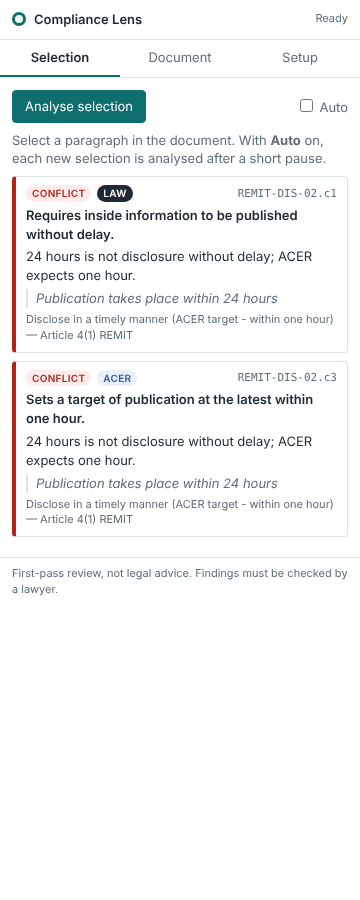
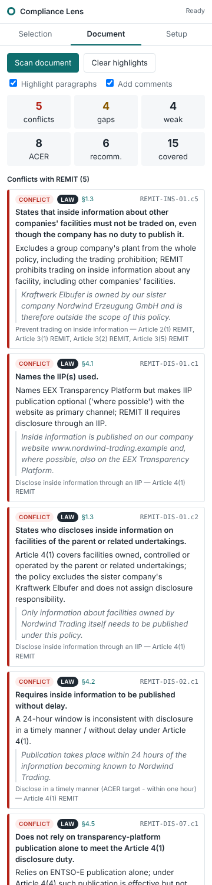

# Compliance Lens

A Word add-in that reads a company's internal compliance procedures and flags what they miss or get wrong under **REMIT** (EU wholesale energy market integrity). Each finding comes with the legal source. You can select a passage to check it on its own, or scan the whole document. Conflicts are highlighted pink and gaps yellow, with an optional Word comment on each.

> Personal open-source project. It uses only public sources and fictional demo documents. **It is not legal advice**: findings are a first pass for a lawyer or compliance officer to check.

<p> </p>

## Quick start

Compliance Lens runs on your own computer. Your documents never go to a server of ours. The only place the text goes is Claude, for the analysis.

**You need**
- macOS or Linux, with Python 3.10 or newer, and [Node.js](https://nodejs.org) (only once, to create a local HTTPS certificate)
- **Word for Mac**, or **Word on the web**, which is free with a Microsoft account
- Access to Claude, in one of two ways:
  - a Claude Pro/Max plan with [Claude Code](https://docs.claude.com/en/docs/claude-code) installed and logged in (`claude auth login`), or
  - an Anthropic API key, billed per use

**Steps**

```bash
git clone https://github.com/skraptt/compliance-lens.git
cd compliance-lens
./scripts/setup.sh      # once: Python packages, localhost certificate, add-in registration
./scripts/start.sh      # each time: starts the local server; keep the window open
```

Then open a document in Word:

- **Word for Mac:** restart Word. **Compliance Lens** appears at the right of the **Home** tab.
- **Word on the web:** go to **Home → Add-ins → More Add-ins → My Add-ins → Upload My Add-in**, choose `addin/manifest.xml` and click Upload. Word on the web can only open files stored in OneDrive.

## Try the demo

1. Open `demo/nordwind/transaction-reporting-procedure.docx` in Word and click **Compliance Lens**.
2. In **Setup**:
   - tick *Transaction reporting procedure* and *Registration procedure*;
   - click **Use the fictional demo company (Nordwind)**.
3. In **Document**, click **Scan document**. The scan takes a few minutes.

You should see the five planted conflicts:
- registration changes notified only once a year (§1.3)
- orders to trade not reported (§2.2)
- exchange trades reported a second time (§2.4)
- intragroup trades not recorded (§2.5)
- non-standard contracts reported within one month instead of ten working days (§3.2)

The other two demo documents are `inside-information-policy.docx` (*Inside information policy*) and `market-conduct-policy.docx` (*Market conduct / trading policy* and *Algorithmic trading policy*).

## Which documents to use

Only analyse documents you are allowed to send to Anthropic (Claude). Do not use an employer's or a client's internal procedures without permission. Note also that **Add comments** writes the findings into the document itself.

## How it works

1. **Checklist** (`obligations/remit.yaml`): 41 REMIT obligations with 158 checks, plus a MAR block and 15 good-practice items. Every check is tagged:
   - `law`
   - `guidance` (an ACER expectation)
   - `good_practice`

   Only missing `law` checks are reported as gaps. Sources were verified through the [REMIT MCP](https://github.com/skraptt/remit-mcp).
2. **Profile**: what the company is decides which obligations apply. For example: does it own assets, trade with algorithms, act as a broker?
3. **Document type**: each check runs on the procedure where it belongs. Examples are an inside information policy, a market conduct policy or a transaction reporting procedure.
4. **Analysis**: Claude rates each check against the numbered paragraphs as `covered`, `partial`, `missing` or `contradicts`, citing the paragraph, a quote and the reason.
5. **Result**: findings are grouped as follows, and obligations not yet in force are listed separately:
   - conflicts
   - gaps
   - weak points
   - ACER expectations
   - recommendations

**Measured quality.** On the fictional Nordwind documents, Claude Sonnet with the current prompt got 95% of the 109 checks right. It found all 19 planted errors (recall 100%, precision 93%). Details are in [examples/nordwind-sonnet-v2](examples/nordwind-sonnet-v2).

## Command line

The same engine runs without Word and writes a Markdown report:

```bash
.venv/bin/python -m lens analyze demo/nordwind/profile.yaml --backend claude-code --out runs/nordwind
.venv/bin/python -m lens eval runs/nordwind/findings.json demo/nordwind/answer_key.yaml
```

Leave out `--backend claude-code` to use `ANTHROPIC_API_KEY`. There are also offline options:
- `--dry-run` prints the prompts
- `--mock-key demo/nordwind/answer_key.yaml` uses a fake model

Tests: `python -m unittest discover tests` and `node --test tests/logic.test.js`.

More on the add-in, including troubleshooting, is in [addin/README.md](addin/README.md).

## Layout

```
obligations/remit.yaml   checklist (v0.3) · CHANGELOG.md · REMIT-obligations-review.md
lens/                    engine: checklist selection, document reader, Claude call, report, eval, local server
addin/                   Word add-in: manifest, task pane, icons
scripts/                 setup.sh, start.sh, checklist checker, md -> docx
demo/nordwind/           fictional company: profile, three procedures, answer key
examples/                recorded runs on the demo
reviews/                 independent reviews of the checklist
tests/                   offline tests
```

## Limits

- REMIT only for now. MAR appears only as an adjacent regime.
- The checklist has been reviewed against the sources, but not yet signed off by a practising lawyer.
- Windows has not been tested. Word on the web may work if you start the server by hand (`python -m lens serve`).
- Office.js has no hover event, so analysis works on the passage you select.

## Licence

The code is licensed under [Apache-2.0](LICENSE). The checklist, demo documents, answer key and reviews are licensed under [CC BY 4.0](LICENSE-DATA.md). Cited legal texts and guidance remain the property of their publishers.
